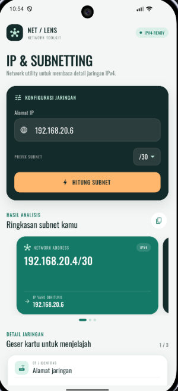

# IP & Subnetting Calculator

Aplikasi Flutter untuk menghitung informasi subnet IPv4 dengan tampilan yang
ringkas dan mudah dibaca. Antarmuka menggunakan font Oswald dari Google Fonts.

## Fitur

- Validasi alamat IPv4 dan perhitungan untuk prefix `/0` hingga `/32`.
- Menampilkan network address, subnet mask, wildcard, broadcast, rentang host,
  jumlah host, dan klasifikasi alamat.
- Mendukung subnet `/31` point-to-point dan `/32` single-host.
- Menyalin ringkasan hasil ke clipboard.

## Tangkapan layar



## Menjalankan aplikasi

```shell
flutter pub get
flutter run
```

Jalankan pengujian dengan `flutter test`.
